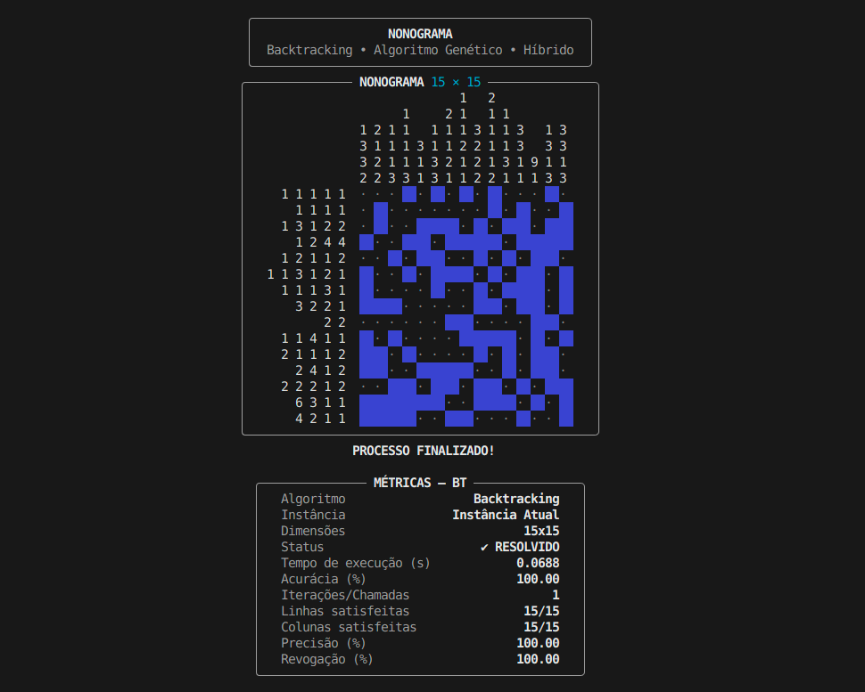

# Nonogram Solver — Comparação de Algoritmos

Projeto desenvolvido em Python para resolução de puzzles Nonograma, utilizando três abordagens algorítmicas: **Backtracking, Algoritmo Genético e Método Híbrido**.

Projeto desenvolvido em Python para resolução de puzzles **Nonograma**, utilizando três abordagens algorítmicas: Backtracking, Algoritmo Genético e Método Híbrido.

O objetivo é implementar e comparar diferentes estratégias computacionais aplicadas a um problema de satisfação de restrições e otimização combinatória.

## Sobre o projeto

Nonograma é um puzzle lógico baseado em uma grade de células. O objetivo é identificar quais células devem ser preenchidas a partir de pistas numéricas associadas às linhas e colunas.

Este projeto implementa três métodos de resolução, permitindo observar diferenças entre estratégias de busca exata e métodos estocásticos.

## Algoritmos implementados

### 1. Backtracking

Método de busca exata que explora sistematicamente as possibilidades de preenchimento do tabuleiro.

A implementação utiliza restrições e critérios heurísticos para orientar a escolha das configurações e descartar possibilidades inválidas, reduzindo o espaço de busca.

### 2. Algoritmo Genético

Método de otimização estocástico inspirado na evolução biológica.

Trabalha com uma população de soluções candidatas, aplicando mecanismos como seleção, cruzamento e mutação para buscar configurações que satisfaçam as restrições do problema.

Por sua natureza estocástica, não garante encontrar uma solução exata em todas as execuções.

### 3. Método Híbrido

Combina o Algoritmo Genético com o Backtracking, buscando aproveitar características complementares das duas abordagens.

O Algoritmo Genético realiza a busca inicial. Caso não encontre uma solução exata, o Backtracking é utilizado na etapa seguinte para tentar encontrar uma solução válida.

## Tecnologias e conceitos

- Python 3
- Rich — interface e apresentação no terminal
- Algoritmos de busca
- Backtracking e recursividade
- Algoritmos Genéticos
- Heurísticas de busca
- Otimização combinatória

## Estrutura do projeto

```text
Nonograma/
├── instancias/
│   ├── nonogram_5x5.txt
│   ├── nonogram_10x10.txt
│   ├── nonogram_20x20.txt
│   └── ...
├── screenshots/
│   └── backtracking.png
├── generator.py
├── main.py
├── metodos.py
├── metricas.py
├── tabuleiro.py
├── requirements.txt
├── .gitignore
└── README.md
```

### Principais arquivos

| Arquivo | Responsabilidade |
|---|---|
| `main.py` | Inicialização e fluxo principal do programa |
| `metodos.py` | Implementação dos algoritmos de resolução |
| `metricas.py` | Cálculo e organização das métricas |
| `tabuleiro.py` | Manipulação e exibição do tabuleiro |
| `generator.py` | Geração de instâncias |
| `instancias/` | Arquivos de entrada dos Nonogramas |
| `screenshots/` | Capturas de tela do programa |

## Instalação e execução

### Pré-requisitos

- Python 3.8 ou superior.
- Git, para clonar o repositório.

### 1. Clonar o repositório

```bash
git clone https://github.com/michelleegit/nonogram-solver-algorithms-.git
```

### 2. Acessar a pasta do projeto

```bash
cd nonogram-solver-algorithms-
```

### 3. Instalar as dependências

```bash
python3 -m pip install -r requirements.txt
```

### 4. Executar o programa

Para iniciar com uma instância específica:

```bash
python3 main.py instancias/nonogram_5x5.txt
```

Também é possível executar sem argumentos:

```bash
python3 main.py
```

Nesse caso, o programa solicitará o caminho do arquivo de entrada.

### 5. Selecionar o algoritmo

Após carregar a instância, o usuário poderá escolher:

1. Backtracking
2. Algoritmo Genético
3. Método Híbrido

## Demonstração

### Backtracking — Instância 15×15



## Resultados experimentais

Foram realizados testes com instâncias de diferentes dimensões, permitindo observar o comportamento dos três algoritmos.

| Instância | Algoritmo | Tempo (s) | Acurácia | Resultado |
|---|---|---:|---:|---|
| 5×5 | Backtracking | 0,0002 | 100% | Resolvido |
| 5×5 | Genético | 0,0027 | 100% | Resolvido |
| 5×5 | Híbrido | 0,0081 | 100% | Resolvido |
| 10×10 | Backtracking | 0,0032 | 100% | Resolvido |
| 10×10 | Genético | 1,4561 | 100% | Resolvido |
| 10×10 | Híbrido | 0,1327 | 100% | Resolvido |
| 20×20 | Backtracking | 2,3606 | 100% | Resolvido |
| 20×20 | Genético | 14,2668 | 55% | Melhor aproximação |
| 20×20 | Híbrido | 3,0871 | 100% | Resolvido |

*Observação: os tempos correspondem a execuções individuais realizadas no ambiente de desenvolvimento. Não representam médias de múltiplas execuções. Os resultados do Algoritmo Genético e do Método Híbrido podem variar devido à natureza estocástica dos métodos.*

## Análise dos resultados

Os experimentos evidenciaram diferenças no comportamento das estratégias implementadas.

- **Backtracking:** apresentou excelente desempenho nas instâncias menores e resolveu a instância 20×20 em aproximadamente 2,36 segundos.
- **Algoritmo Genético:** encontrou soluções exatas nas instâncias 5×5 e 10×10. Na instância 20×20, alcançou uma aproximação com 55% de acurácia, sem encontrar a solução exata dentro do limite de gerações utilizado.
- **Método Híbrido:** resolveu todas as instâncias apresentadas, incluindo a 20×20, na qual o Algoritmo Genético isolado não encontrou uma solução exata.

Os resultados sugerem que a combinação de estratégias pode ser vantajosa em determinadas instâncias. Entretanto, são necessários experimentos adicionais para estabelecer conclusões gerais sobre desempenho e escalabilidade.

## Objetivos de aprendizagem

O desenvolvimento deste projeto envolveu a aplicação prática de conceitos de:

- Projeto e implementação de algoritmos.
- Busca em espaços de estados.
- Satisfação de restrições.
- Otimização combinatória.
- Computação evolutiva.
- Comparação experimental de algoritmos.
